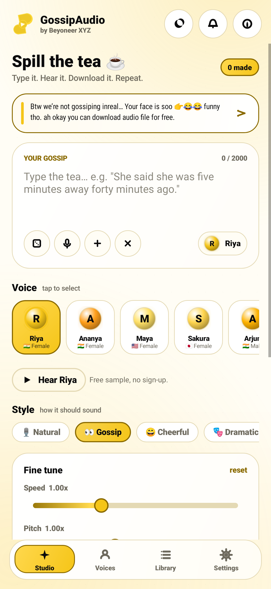
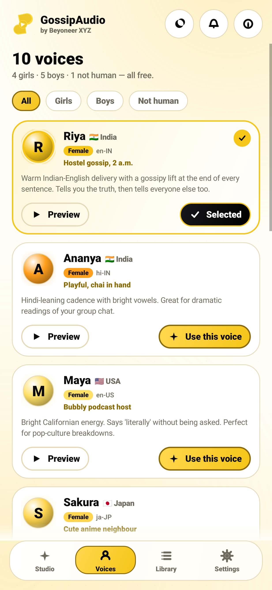
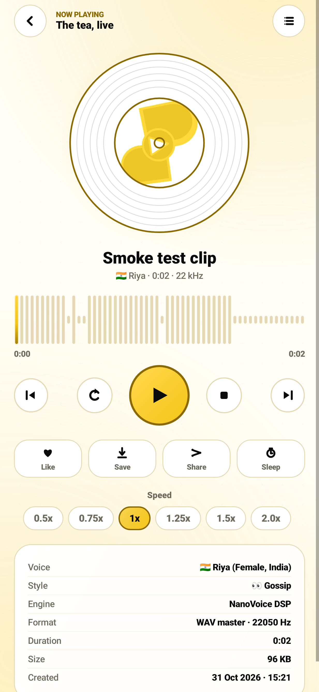
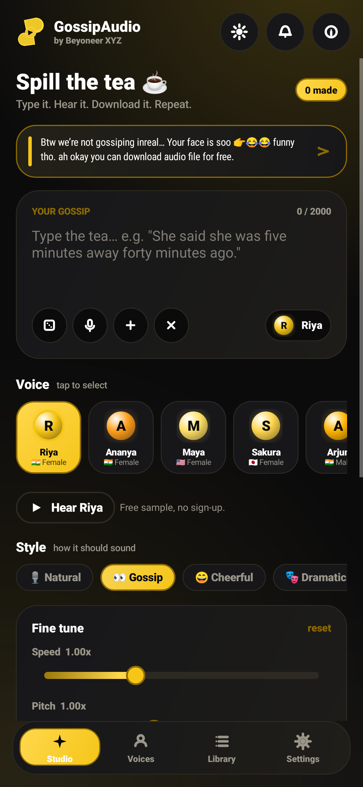

# GossipAudio <sub>by Beyoneer XYZ</sub>

**Btw we're not gossiping inreal... Your face is soo 🫵🤣😂 funny tho. ah okay you can download audio file for free.**

A complete, offline Android voice-studio: type text → pick one of ten voices → get a real WAV, MP3 or M4A
file you can download and share. No account, no cloud, no "premium" wall, no fake demo.

<p align="center">
  
</p>

> ### ⬇️ The app is one file: [`GossipAudio-1.0.1-release.apk`](https://github.com/MagmaMines/Gossip-Audio/raw/arena/b73dc5e5-gossip-audio/dist/GossipAudio-1.0.1-release.apk)
> Tap that link on your phone → install. No unzipping, no folder, no "extract here".
> If you ever end up with **`gossipaudio-apk.zip`**, that came from GitHub's *workflow artifact*
> wrapper (GitHub always zips CI artifacts) — it is not our download and this build no longer
> publishes one. The real file is the `.apk` above (or the **Releases** page).

| | |
|---|---|
| **App id** | `xyz.beyoneer.gossipaudio` |
| **Version** | 1.0.1 (versionCode 2) |
| **Min / target SDK** | 24 (Android 7.0) / 35 (Android 15) |
| **Language** | 100 % Kotlin + pure-Java DSP, framework APIs only (no AndroidX, no native `.so`) |
| **Download** | [`dist/GossipAudio-1.0.1-release.apk`](dist/GossipAudio-1.0.1-release.apk) — a signed, installable APK (no zip, no bundle) |
| **Also here** | [`debug`](dist/GossipAudio-1.0.1-debug.apk) · [`AAB` for Play Console](dist/GossipAudio-1.0.1.aab) · install help: [`docs/INSTALL.md`](docs/INSTALL.md) |
| **Proof it works** | [`dist/samples/pipeline-sample.mp3`](dist/samples/pipeline-sample.mp3) — generated by the app's own engine during CI |
| **Tests** | 17 JVM tests: audio pipeline, end-to-end Generate, UI render smoke, accessibility + haptics + back-stack |
| **Signed by** | RSA-4096 / SHA-512, APK Signature Scheme v2 — re-verified byte-for-byte by `tools/apksig.py` in CI |

---

## Look at it first

| | |
|---|---|
|  |  |
| Studio — composer, 10 voices, 8 moods, live telemetry | Voices — 4 girls · 5 boys · 1 not human, previews included |
|  |  |
| Player — vinyl, seekable waveform, download/share/sleep | Dark theme — same yellow, system black |

These are **real renders**: CI boots the activity, walks the tabs and rasterises the view tree
(`UiSmokeTest`). Full gallery: [`docs/SCREENSHOTS.md`](docs/SCREENSHOTS.md).

---

## Install in 30 seconds

1. Download [`dist/GossipAudio-1.0.1-release.apk`](dist/GossipAudio-1.0.1-release.apk) on your phone.
   That file **is** the app — nothing to unzip.
2. Tap it, allow "install unknown apps" if Android asks.
3. Open **GossipAudio**, skip the intro, type a sentence, hit **Generate**, then **Download**.

The APK is signed with the project release key (`keystore/gossipaudio-release.jks`, alias `gossipaudio`),
so updates install over each other without uninstalling.

> Android 13+ asks for notification permission only when you actually start playback or turn on reminders.
> The microphone permission is only requested when you tap the dictation mic. Deny both and the app still works.

### "Is the APK a zip?" Yes — and that is correct

An `.apk` *is* a ZIP container: that is how Android packs the binary manifest, the dex code and the
images into one file. What makes it an app is the **Android binary manifest** plus the **APK Signing
Block** — an archive rename cannot fake either. This repo ships **no `.zip` of the app**; the only
download is the signed APK. Full guide, ADB commands and troubleshooting:
[`docs/INSTALL.md`](docs/INSTALL.md).

Prove the signature yourself (pure Python, no SDK, no `apksigner`):

```
$ python3 tools/verify_apk.py dist/GossipAudio-1.0.1-release.apk
 * signature VERIFIED: RSA-PKCS1/SHA-512 / RSA-4096, certificate sha256 ead721ae…, 4 chunks
--- problems
 none — APK structure, manifest, signing and dex contents check out
```

---

## What you get (28 features, all wired to real code)

### Voices & speech
1. **10 selectable voices** — 4 female, 5 male, 1 non-human robot.
   `Riya` (en-IN), `Ananya` (hi-IN), `Maya` (en-US), `Sakura` (ja-JP), `Arjun` (en-IN), `Rohan` (hi-IN),
   `Jordan` (en-US), `Oliver` (en-GB), `Kenji` (ja-JP), `BOT` (non-human).
2. **Two speech engines, one button** — the phone's on-device neural TTS when it exists, and
   **NanoVoice**, the app's own formant synthesiser, when it doesn't. You never get a dead Generate button.
3. **8 emotion presets** — Natural, Gossip, Cheerful, Dramatic, Whisper, News, Roast, Robot.
4. **Speed control** 0.5× – 2.0× and **pitch** ±12 semitones, baked into the rendered audio.
5. **Random gossip generator** — the dice writes a sentence for you when your imagination is on holiday.

### Audio out
6. **WAV (PCM 16-bit)** — lossless, opens anywhere.
7. **MP3 up to 320 kbps** — a complete LAME port compiled as Java, no NDK, no ffmpeg.
8. **M4A / AAC "audio image"** — `MediaCodec` AAC muxed into MP4, then tagged with title/artist/cover.
9. **Embedded cover art** — auto-generated brand covers or your own photo (ID3 `APIC` + iTunes `covr`).
10. **Downloads folder export** — `Downloads/GossipAudio` via MediaStore, with a fallback picker on Android 9 and below.
11. **One-tap share sheet** — exports to MP3 and opens the system share dialog.

### Player
12. **Play / pause / stop / replay / next / previous** with a spinning vinyl, live waveform and seek-by-tap.
13. **Background playback** — foreground service + media notification with lock-screen controls.
14. **Sleep timer** — 5, 15, 30 or 60 minutes, then the audio politely stops.
15. **Bass boost + EQ** — real `AudioEffect` on the playback session, toggleable.
16. **Playback speed chips** — 0.5× to 2× independent of the rendered file.

### Library
17. **Every clip indexed** in a JSON store with title, voice, style, duration, size and cover.
18. **Search** by title, text or voice; **filter** favourites.
19. **Like** (heart) any clip, **rename**, **delete**, or **delete all**.
20. **Orphan sweeper** — deletes audio files whose metadata vanished, keeps the library honest.

### Input & text
21. **Speech-to-text dictation** — the system recogniser, offline-preferred if you enable it in Settings.
22. **Text tools** — live word count, live duration estimate, title auto-generation, sanitising.

### App polish
23. **Butterfly loader** with a real percentage bar and a cancel button.
24. **Yellow/white + system dark theme** — buttons are yellow with a thin darker-yellow outline,
    white text on black, black text on yellow. Theme switch: System / Light / Dark.
25. **Live telemetry card** — CPU, RAM, GPU renderer, battery-free device facts from the actual device.
26. **Self-test screen** — synthesises, writes WAV, encodes MP3, tags it, muxes AAC and reports each step.
27. **Daily gossip reminder** — one notification a day at the time you pick, scheduled with `AlarmManager`.
28. **Diagnostics + Help** — 24 honest answers, open-source licences, device report.

---

## Screens

```
Splash (butterfly)  →  Onboarding (3 pages, skippable)  →  Shell
                                                            ├── Studio   (composer, voices strip, styles, speed/pitch)
                                                            ├── Voices   (10 cards, filters, previews)
                                                            ├── Library  (search, favourites, download/share)
                                                            └── Settings (theme, formats, reminders, dictation, about)
                                                                    └── Player · About · Diagnostics · Help · Dictation sheet · Export sheet
```

Everything is drawn with custom `View`s — the butterfly, icons, waveforms, sparklines, vinyl and the
butter-yellow gradients. No vector assets to bloat the APK, no third-party UI kit.

---

## How it works (short version)

```
 text ──► SpeechSynth ──┬─► System TTS ──► PCM (24 kHz)  ┐
                        └─► NanoVoice  ──► PCM (22 kHz)  ├─► AudioFx ─► WAV master (files/clips)
                                                          ┘                 │
                                                                            ├─► Mp3Encoder (LAME/Java) ─► Id3 (APIC cover) ─► .mp3
                                                                            ├─► AacEncoder (MediaCodec) ─► Mp4Tagger ────────► .m4a
                                                                            └─► MediaStore ─► Downloads/GossipAudio
```

* **No network permission is used for audio.** Synthesis, encoding, tagging and export are local.
  (The manifest declares no `INTERNET` permission at all.)
* **Threading:** synthesis, encoding and file writes run on background threads; results hop back to
  the main thread through a `Handler`. The UI never blocks on a 30-second render.
* **Storage:** `files/clips/<id>.wav` (master), `files/covers/<id>.jpg`, `files/clips.json` (index).

Full details: [`docs/ARCHITECTURE.md`](docs/ARCHITECTURE.md) · formats, [`docs/AUDIO-FORMATS.md`](docs/AUDIO-FORMATS.md)
· voices, [`docs/VOICES.md`](docs/VOICES.md) · feature-by-feature proof, [`docs/FEATURES.md`](docs/FEATURES.md)
· build & CI, [`docs/BUILD.md`](docs/BUILD.md) · screenshots, [`docs/SCREENSHOTS.md`](docs/SCREENSHOTS.md)
· manual QA, [`docs/QA-CHECKLIST.md`](docs/QA-CHECKLIST.md) · store listing, [`docs/STORE.md`](docs/STORE.md)
· installing the APK (and why a zip cannot be one), [`docs/INSTALL.md`](docs/INSTALL.md).

---

## Build it yourself

```bash
git clone https://github.com/MagmaMines/Gossip-Audio
cd Gossip-Audio
./gradlew assembleRelease        # needs JDK 17 + Android SDK 35
```

No Gradle wrapper? Use any Gradle 8.11+ (`gradle assembleRelease`) or let CI do it:

* every push to `main` / the development branch runs `.github/workflows/android.yml`;
* the workflow installs the SDK, runs the JVM pipeline tests, builds debug + release + AAB,
  publishes `dist/` **back into the repository**, and commits `ci-logs/failure.txt` if something breaks.

Signing keys are read from `GA_STORE_PASSWORD`, `GA_KEY_ALIAS`, `GA_KEY_PASSWORD`
(defaults exist for this demo project — rotate them for a real store release).

---

## Tests

```
$ gradle testDebugUnitTest
PipelineTest            8 tests   0 failed   NanoVoice → WAV → MP3 → ID3, styles, effects, text tools
StudioGenerateTest      1 test    0 failed   type → Generate → real clip + cover + MP3 re-export (11 s)
UiSmokeTest             4 tests   0 failed   boot, all tabs, player, About/Help/Diagnostics, dark theme
AccessibilityTest       4 tests   0 failed   TalkBack names, Switch/SeekBar roles, haptics gate, back stack
TOTAL                  17 tests  0 failed
```

The committed run is [`dist/TEST_REPORT.txt`](dist/TEST_REPORT.txt); CI regenerates it on every push and
fails the build on any regression.

The tests run the **same** classes the APK runs, and write real audio into
`app/build/test-samples/` (published to [`dist/samples/`](dist/samples/)).

Two more suites keep the app honest:

* `UiSmokeTest` — Robolectric boots `MainActivity`, waits out the splash, opens all four tabs, the player,
  About, Help and Diagnostics, asserts on the rendered text and saves nine PNG screenshots.
* `tools/verify_apk.py` + `tools/verify_audio.py` — run in CI after every build; they parse the binary
  manifest, the APK signing block, the dex string table, RIFF/WAVE headers, ID3v2.3 frames and MPEG
  frame headers. Output is committed as [`dist/VERIFICATION.txt`](dist/VERIFICATION.txt).
* `tools/apksig.py` — a from-scratch APK Signature Scheme v2 verifier. It recomputes the chunked
  content digest and checks the RSA signature, so "signed" in the build log means *cryptographically
  proven*, not "a file named `.RSA` exists".

## Accessibility & comfort (not an afterthought)

* Every icon-only control has a spoken name; TalkBack reads "Back", "Play", "Like <clip>", not "button".
* Custom `ToggleSwitch` and `NeonSlider` report themselves as a **Switch** and a **SeekBar**, expose
  their checked state / value range, and accept TalkBack's "set progress" and scroll actions.
* The Haptics switch is wired to real `performHapticFeedback` calls on every press (and the toggle
  previews itself when you turn it on).
* Reduce motion is honoured by the router, pop-ins, press scaling, the glowing button and the toggle
  knob; it also follows the system "Remove animations" setting.
* Toasts are live regions, the loading overlay announces progress, and the sheet scrim is skipped by
  screen readers.
* Back gesture works under Android 14/15 predictive back (registered `OnBackInvokedCallback`), and the
  screen stack survives process death instead of showing a blank window.

---

## Privacy

No analytics, no crash reporting, no ads, no network permission. Your text never leaves the phone.
See [`docs/PRIVACY.md`](docs/PRIVACY.md).

## Licences

* App code © 2025 Beyoneer XYZ.
* MP3 encoding uses a vendored copy of [jump3r](https://github.com/tsichevski/jump3r), a Java port of
  LAME, licensed **LGPL-2.1** — see [`licenses/LGPL-2.1-jump3r-LAME.txt`](licenses/LGPL-2.1-jump3r-LAME.txt)
  and [`licenses/NOTICE.md`](licenses/NOTICE.md). The vendored sources stay replaceable at
  `app/src/main/java/ru/wowa/jump3r/**`.
* Everything else (icons, butterfly, covers) is drawn in code by this project.

---

<sub>Made with an unreasonable amount of yellow. If the app ever says something rude, that was the Roast preset.</sub>
