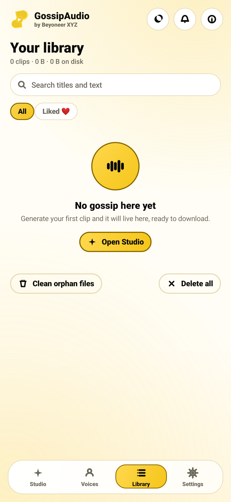
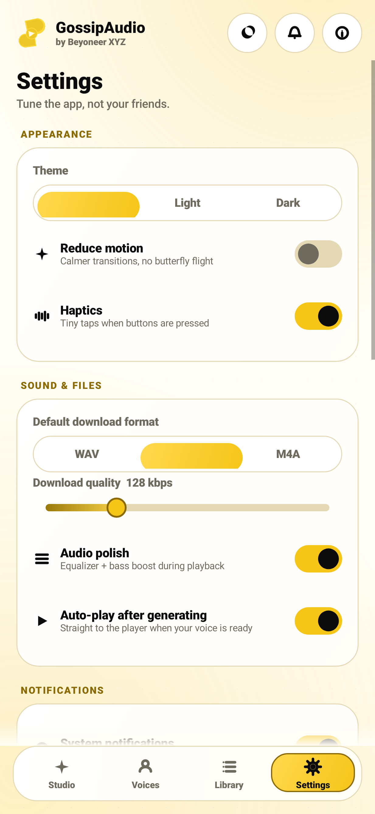
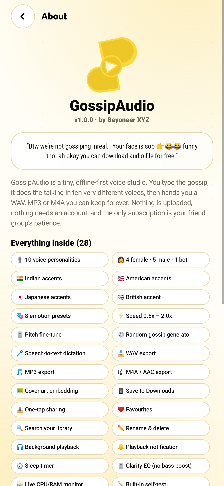
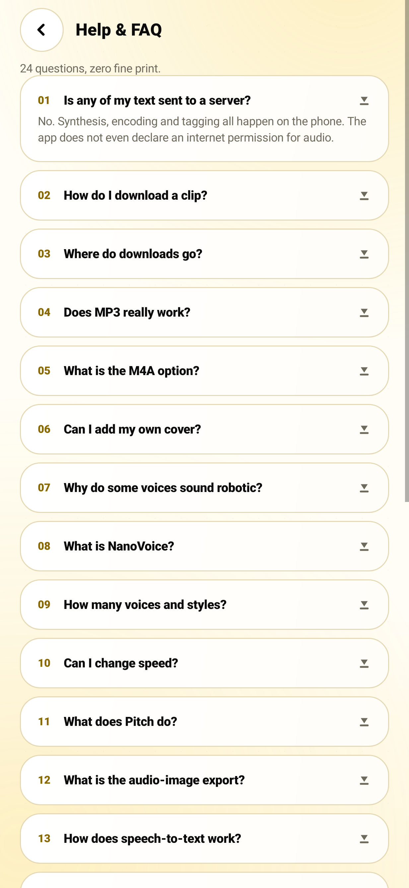
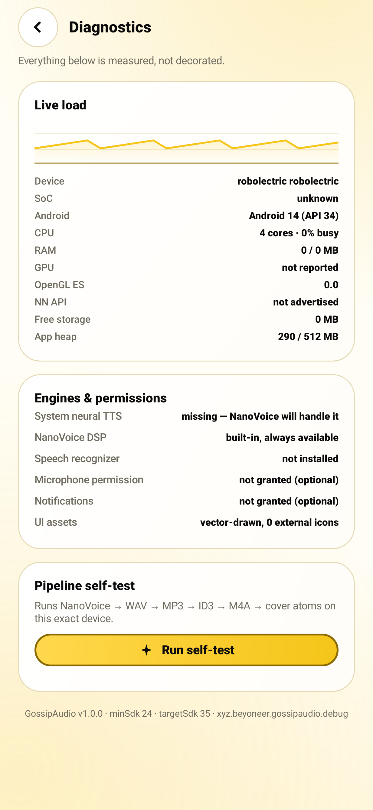

# Screenshots — real renders, not mockups

Every image below is produced by the test suite (`UiSmokeTest`) inside CI: Robolectric boots the real
`MainActivity`, the real splash timer fires, the real tabs are created, and the decor view is rasterised
to a PNG. If a screen ever stops rendering, the build fails instead of shipping a pretty promise.

Regenerate at any time:

```bash
gradle testDebugUnitTest --tests "xyz.beyoneer.gossipaudio.UiSmokeTest"
# → app/build/ui-shots/*.png  (CI copies them to dist/shots/)
```

---

## Studio — where the gossip happens


Greeting card, the exact tagline, composer with word counter, the ten-voice strip, eight style chips,
speed/pitch fine-tuning, telemetry card and the recents carousel — all in one scroll.

## Voices — ten personalities, four filters


`All · Girls · Boys · Not human` filters, per-voice accent colour, region flags, a one-tap **Preview**
(real synthesis, cached to `cacheDir/previews`) and **Use this voice**.

## Library — searchable, likeable, downloadable



Search by title, text or voice; filter favourites; the empty state explains itself instead of showing a
sad grey box.

## Settings — every knob, honestly labelled



Theme (System/Light/Dark), reduce motion, haptics, default download format + quality, audio polish,
auto-play, notifications, dictation, storage, and the doors to Help / Diagnostics / About.

## Player — vinyl, waveform, transport


Spinning vinyl with the cover, seekable waveform, play/pause/stop/replay/next/previous, quick actions
(Like · Save · Share · Sleep), speed chips and a metadata table that names the engine that rendered the
file.

## About — the tagline lives here too



Version, author, the verbatim tagline and the full 28-feature list.

## Help & Diagnostics

| | |
|---|---|
|  |  |
| 24 accordion answers | live CPU/RAM/GPU, engine availability, self-test |

## Dark theme — same brand, black background


Yellow stays exactly `#F5C518`; surfaces flip to `#0B0B0C`, text to white, outlines to a warm dark
gold. Buttons keep their thin darker-yellow border in both themes.
